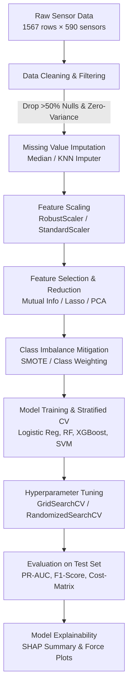

# Machine Learning Lab Course Project Plan (AIM 3130)

---

## 📋 Project Specifications & Instructor Constraints
- **Course**: Machine Learning Lab (AIM 3130)
- **Target Deadline for Group Formation**: 5th August
- **Team Size**: 3–4 Members
- **Scope**: Strictly Classical Machine Learning (Tabular / Numerical Datasets only)
- **Objective**: Build an end-to-end, reproducible, and explainable Machine Learning pipeline addressing a challenging, non-trivial real-world problem.

---

## 🎯 Recommended Project Options (Uncommon & High-Impact)

### 🥇 Option 1 (Primary Proposal): Semiconductor Wafer Fault Detection & Sensor Attribution (SECOM)
* **Domain**: Industrial Manufacturing / Yield Engineering / Sensor Analytics
* **Problem Statement**:
  During semiconductor fabrication, continuous sensor telemetry captures hundreds of physical and chemical parameters per wafer. Identifying defective wafers early avoids huge financial losses. However, the dataset exhibits:
  1. **Extreme High-Dimensionality**: 590 continuous sensor features.
  2. **Severe Class Imbalance**: ~14:1 ratio of passing wafers to failing wafers (only ~6.6% defect rate).
  3. **High Missingness & Collinearity**: Sensor disconnections and correlated physical readings.
* **Dataset**: [UCI SECOM Dataset](https://archive.ics.uci.edu/dataset/179/secom)
  - **Instances**: 1,567 wafers
  - **Features**: 591 numerical continuous signals
  - **Target**: `Status` (-1 = Pass / Non-defective, +1 = Fail / Defective)
* **Why It Stands Out**:
  Unlike common academic datasets (Iris, Titanic, Boston), this reflects authentic production-line challenges: feature selection on 500+ features, handling high missing rates, cost-sensitive learning (minimizing False Negatives), and Explainable AI (SHAP) to tell engineers *which specific sensors caused the failure*.

---

### 🥈 Option 2: Space Weather & Geomagnetic Storm ($Dst$ Index) Prediction
* **Domain**: Astrophysics / Space Science / Satellite Safety
* **Problem Statement**:
  Predicting disturbances in Earth's magnetic field (Disturbance Storm Time, $Dst$ index) caused by solar wind plasma to prevent satellite damage and electrical power grid blackouts.
* **Dataset**: NOAA Space Weather Prediction Center / NASA OMNIWeb Tabular Solar Wind Data.
  - **Features**: Solar wind proton density, speed, temperature, Interplanetary Magnetic Field (IMF) vector components ($B_x, B_y, B_z, B_{total}$).
  - **Target**: Continuous hourly $Dst$ index (Regression) or Storm Severity Class (Minor, Moderate, Severe, Extreme).
* **Key Challenges**: Time-lagged feature engineering, non-linear solar-terrestrial coupling, and high-impact extreme event forecasting.

---

### 🥉 Option 3: Enzyme Thermal Stability & Melting Temperature ($T_m$) Modeling
* **Domain**: Computational Biochemistry / Biocatalysis
* **Problem Statement**:
  Predicting the thermal stability (melting temperature $T_m$ in °C) of proteins and engineered enzymes using derived physicochemical and sequence-level numerical tabular descriptors.
* **Dataset**: Kaggle / Novozymes Enzyme Stability Tabular Descriptors Dataset.
  - **Features**: Isoelectric point ($pI$), molecular weight, hydropathy index, amino acid frequencies, secondary structure percentages (helix, beta-sheet, coil fractions).
  - **Target**: Continuous melting temperature $T_m$ (°C).
* **Key Challenges**: Multicollinearity among chemical descriptors, robust cross-validation across protein families, and regularized regression (Ridge, Lasso, ElasticNet, Gradient Boosting).

---

## 🏗️ End-to-End Pipeline Architecture (SECOM Proposal)



---

## 👥 Team Workload & Role Division (3–4 Members)

| Member | Role | Key Deliverables & Responsibilities |
| :--- | :--- | :--- |
| **Member 1** | **Data Engineering & Preprocessing Specialist** | • Profiling dataset, missing value heatmap, and distribution analysis.<br>• Filtering zero/low variance sensor channels.<br>• Implementing robust imputation (Median/Iterative Imputer) and scaling (`RobustScaler`).<br>• Script: `src/preprocessing.py` |
| **Member 2** | **Feature Engineering & Selection Specialist** | • Multicollinearity analysis and correlation threshold filtering.<br>• Feature importance ranking via Mutual Information and Tree-based methods.<br>• Dimensionality reduction experiments (PCA vs. SelectKBest).<br>• Script: `src/feature_selection.py` |
| **Member 3** | **Model Architecture & Tuning Specialist** | • Handling severe class imbalance using SMOTE and cost-sensitive loss.<br>• Baseline models: Logistic Regression, Linear & RBF SVM.<br>• Ensemble models: Random Forest, ExtraTrees, Gradient Boosting (XGBoost/LightGBM).<br>• Stratified K-Fold Cross-Validation & hyperparameter tuning.<br>• Script: `src/models.py` |
| **Member 4**<br>*(or shared)* | **Evaluation, Explainability (XAI) & Documentation** | • Precision-Recall AUC (PR-AUC), Confusion Matrix, and Cost-Utility curves.<br>• Model explainability: SHAP values and feature attribution for root-cause analysis.<br>• Integration into `main.py` and compiling the final report/presentation.<br>• Script: `src/evaluate.py` |

---

## 📂 Proposed Repository Directory Layout

```
project/
├── plan.md                     # This project blueprint
├── data/                       # Raw and processed tabular datasets
│   ├── raw/
│   │   ├── secom.data
│   │   └── secom_labels.data
│   └── processed/
├── src/                        # Modular pipeline components
│   ├── __init__.py
│   ├── preprocessing.py        # Imputation, scaling, variance filtering
│   ├── feature_selection.py    # PCA, Mutual Information, Lasso
│   ├── models.py               # Model definitions & hyperparameter grids
│   └── evaluate.py             # PR-AUC, confusion matrices, SHAP analysis
├── plots/                      # Output figures, EDA, PR curves, SHAP graphs
├── main.py                     # Master execution script
└── requirements.txt            # Python dependencies
```

---

## 📅 Milestones & Timeline

| Phase | Milestone | Deliverable | Target Date |
| :--- | :--- | :--- | :--- |
| **Phase 1** | **Team & Topic Finalization** | Finalize 3-4 member group and submit project proposal to instructor | August 5 |
| **Phase 2** | **Dataset Acquisition & Preprocessing** | Download raw data, null handling, scaling, baseline EDA report | August 15 |
| **Phase 3** | **Feature Selection & Baseline Models** | Select top ~50 sensor signals; implement Logistic Regression & SVM | August 25 |
| **Phase 4** | **Ensemble Modeling & Imbalance Tuning** | SMOTE, Random Forest, XGBoost, and hyperparameter optimization | September 5 |
| **Phase 5** | **Explainability & Final Evaluation** | SHAP root-cause analysis, PR-AUC benchmarking, final report & slides | September 15 |

---

## 📚 References & Resources
1. **UCI Machine Learning Repository**: SECOM Dataset ([archive.ics.uci.edu/dataset/179/secom](https://archive.ics.uci.edu/dataset/179/secom))
2. **Scikit-Learn Documentation**: Imbalance handling, Feature Selection, and Ensemble Methods.
3. **SHAP (SHapley Additive exPlanations)**: Model interpretability for sensor attribution.
